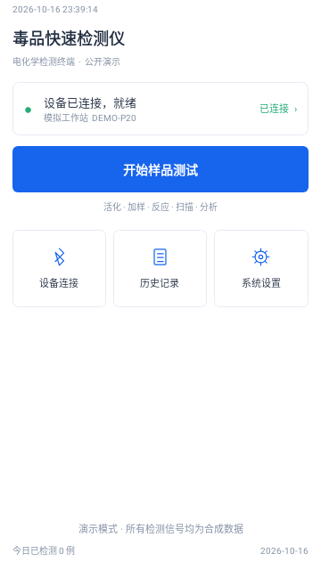
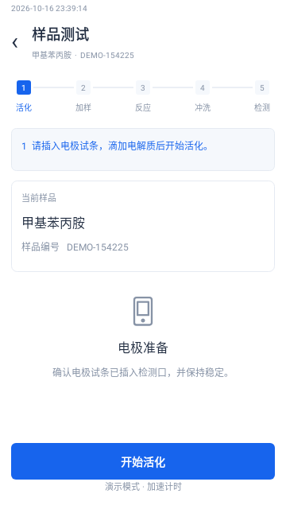
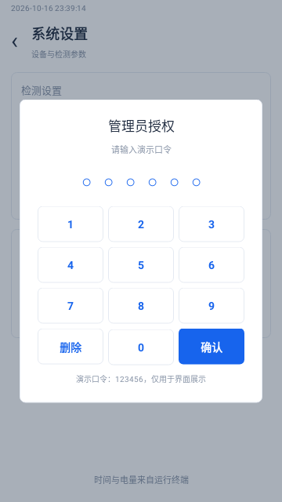
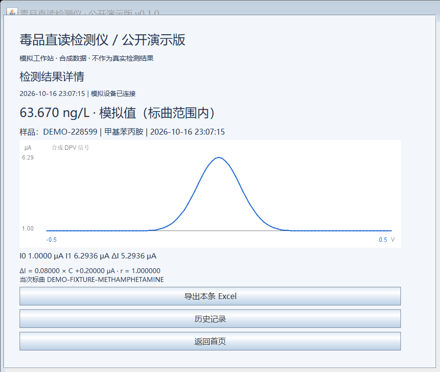

# 便携式毒品直读检测仪 公开演示版

基于功能说明与演示视频独立编写的 Java 功能原型。用于展示检测流程、数学计算和数据管理，不包含原产品源代码、私有通信协议或真实检测数据。**本仓库是公开演示版，不能表述为原设备的完整源码或已通过真实样品验证的检测系统。**

## 基础框架

| 模块 | 技术 | 职责 |
| --- | --- | --- |
| `app` | Android 原生 Java、系统 View、SQLite | 触屏应用、流程引导、记录查询、系统文件选择器导出 |
| `core` | Java 17，无第三方运行依赖 | 状态机、标曲拟合、合成信号、浓度换算、记录编码、XLSX 导出 |
| `desktop` | Java Swing | Windows / macOS / Linux 电脑演示，共用核心逻辑 |

Android 最低版本为 8.0（API 26），编译目标 API 35。构建固定使用 AGP 8.9.2、Gradle 8.11.1、JDK 17；版本兼容关系见 [Android 官方说明](https://developer.android.com/build/releases/agp-8-9-0-release-notes)。

## 按交互界面说明1修改

已新增设备扫描与选择、独立管理员模式、标曲增删改，以及“信息 → 活化 → 曲线 → LOD/LOQ → 导出”五页向导。两端均按参考图片采用白底蓝色、下划线标签、固定底栏、居中弹窗和分页触屏键盘。新增代码及关键流程已补充中文注释。完整操作、截图编号对照和实现边界见 [本次修改说明](docs/INTERFACE_GUIDE.md)。

两端标曲均可持久保存；本地导出真实生成 JSON 与 Excel。新向导采用固定基线差，至少两个浓度点、每点三次重复，支持十次模拟采集计算 LOD/LOQ；旧数学接口保持兼容。

## 原有界面复现

以设备演示视频为主要视觉依据，补充文档中的历史记录和曲线详情。Android 和电脑入口采用一致的竖屏白底、蓝色按钮、三项快捷入口、五段检测步骤条、居中进度弹窗和数字键盘。参照位置及保留差异见 [界面对照说明](docs/UI_REFERENCE.md)。

下图是 Android 原生 View 在 Robolectric 中的实际测试渲染，非真机截图，数据均为合成：

| 首页 | 检测流程 | 管理员弹窗 |
| --- | --- | --- |
|  |  |  |

## 基础功能

本展示版启动后默认连接内置模拟设备，无需连接真实硬件即可运行完整交互。首次启动会自动创建一条“DEMO-METH”甲基苯丙胺药物模板，包含基线、响应曲线、LOD/LOQ 演示数据；所有信号均为合成数据，仅用于界面和流程展示，不代表真实厂家标定、真实样品结果或仪器性能。

- 模拟工作站连接与断开，未连接时禁止检测。
- 选择甲基苯丙胺、吗啡、曲马多、美沙酮及虚构样品编号。
- 确认电极并模拟活化 → 加样 → 等待反应 → 冲洗与添加反应液 → 模拟采集 → 结果保存。
- 5/10 分钟常规计时，以及明确标注的 5 秒演示加速模式。
- 反应等待页提供“跳过计时（展示模式）”，便于快速演示后续冲洗、检测与保存流程。
- 生成合成 DPV 曲线，计算正向峰值及峰电流差，按标曲反算浓度。
- 向导支持 2–10 个浓度点、每点三次重复的一元线性拟合，计算斜率、截距与 Pearson r；拒绝重复浓度、非有限值、零方差和非正斜率。旧的 5–10 点相邻差值接口保留兼容。
- 本地记录、样品编号与类型组合查询、详情、单条/多条 Excel 导出。Excel 同时保存汇总和采样点，所有行带 `SIMULATED` 标记。
- 两端持久保存标曲和检测记录；Android 同时保存计时设置，电脑计时设置在本次会话有效。

## 快速运行电脑演示

安装 JDK 17 或更高版本。在仓库根目录打开 PowerShell：

```powershell
powershell -ExecutionPolicy Bypass -File .\scripts\desktop.ps1
```

该入口无需 Android SDK 和 Gradle 下载，先编译、执行核心验收，再打开演示界面。JDK 的 `java` 和 `javac` 需在 PATH 中。

1. 点击“连接设备”→“重新扫描”→“连接所选设备”。
2. 点击“开始样品测试”，使用自动生成的 `DEMO-…` 编号。
3. 点击“开始活化”，逐步进行模拟活化、加样、反应和采集。默认反应计时为演示加速 5 秒。
4. 查看合成结果、历史记录，选择一条或多条记录导出 `.xlsx`。

电脑记录写入启动目录下的 `data/`，默认不进入 Git。请仅录入虚构编号。

标曲入口为“系统设置”→“开启管理员模式”→输入演示口令 **123456** →“标准曲线管理”。这仅复现数字键盘交互，不提供真实厂家权限控制。计时设置位于“诊断”弹窗。

电脑演示入口的实际结果页面（合成数据）：



## 构建 Android

使用 Android Studio 打开本仓库，设置 Gradle JDK 为 17，安装 Android SDK Platform 35 和 Build Tools 35.0.0。SDK 路径由 Android Studio 写入本地 `local.properties`，此文件不提交。

```powershell
.\gradlew.bat :core:check :app:testDebugUnitTest :app:assembleDebug :app:lintDebug
```

产物为 `app/build/outputs/apk/debug/app-debug.apk`，是调试签名的演示 APK。安装后先连接模拟设备。Android 导出使用系统“另存为”界面，可选择本地或系统已挂载的 U 盘，无需申请所有文件存储权限。取消文件选择不会导出。

仅验证电脑模块时可跳过 Android 插件与 SDK：

```powershell
.\gradlew.bat -PdesktopOnly :core:check :desktop:build
.\gradlew.bat -PdesktopOnly :desktop:run
```

Android 页面重建会取消未完成的演示流程，已写入 SQLite 的结果保留。导出选择若因进程重建丢失，请重新选择记录导出；初版不支持恢复未完成采集。

## 数据与算法边界

检测结果单位为 **ng/L**（浓度）、**μA**（电流）、**V**（电位）。标曲向导按截图显示 **pg/mL** 和 **mV**；1 pg/mL = 1 ng/L。新向导用各浓度平均峰值减已确认基线拟合 `ΔI = kC + b`，反算 `C = (ΔI − b) / k`。旧相邻电流差接口 `y_i = I_i − I_(i−1)` 继续保留兼容。

默认标曲是人为构造的数学样例，`r=1` 来自完全线性合成点；不代表仪器精度。模拟器根据样品编号确定性地生成高斯曲线，所选检测类型是操作输入，不是算法识别结果。更换标曲不会改变模拟器的固定合成模型，结果可能超出区间；页面会标注，且不作阳性/阴性判断。

真实 USB/BLE、DPV/SWV 信号预处理、负向峰、基线漂移校正、扫码、厂家权限与真实样品性能验证均未实现。未提供标准/法规阈值，因此没有超标判定。LOD/LOQ 已实现截图公式和模拟采集交互，不代表真实仪器性能。

详见 [功能范围](docs/SCOPE.md)、[架构与接入](docs/ARCHITECTURE.md)、[验收说明](docs/VALIDATION.md) 和 [公开版本说明](docs/PUBLIC_DISCLOSURE.md)。
