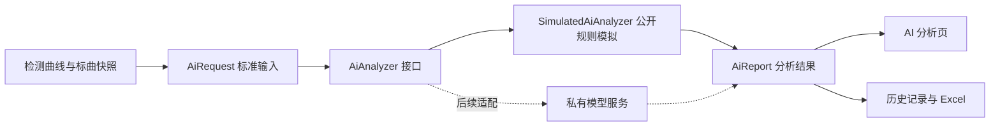

# AI 接口与公开模拟适配器

v1.1.0 增加独立的 AI 服务接口、可替换适配器、分析流程、结果快照和 Excel 字段。此实现未使用老师的私有源码、模型权重、训练集、密钥或私有协议。

## 公开版实际运行的内容



新检测在采集后显示“AI 辅助分析”进度，再保存检测结果与分析快照。结果页可点击“查看 AI 分析”，也可使用第四个标签“AI 分析”。两端延续原有白底蓝色、居中进度、固定底栏和可滚动内容。

公开适配器计算采样点数、最大正向峰的电位/电流、相对基线的净峰电流、首尾各 10% 采样点均值之差，并用规则产生复核建议。峰值位于首尾各 10% 区间或净峰不为正时，演示建议重新采集；其他情况建议人工复核，浓度超出标曲范围时补充提醒。这些是**公开规则和数学特征**，不构成训练模型或仪器质控阈值的验证。

模拟响应的 `mode=SIMULATED`，`predictedDrug=null`、`confidence=null`，界面显示“未执行分类，待真实模型接入”。不会把人工选择类型回填成模型识别答案，也不生成虚构置信度或准确率。分析输入的 `dataOrigin` 沿用检测记录来源（包含模拟标曲参与计算的情况），与 AI 的 `mode` 分开记录，例如真实模型也可能分析模拟数据。

## Java 接口

```java
public interface AiAnalyzer {
  AiReport analyze(AiRequest request) throws IOException;
}
```

| 对象 | 内容 |
| --- | --- |
| `AiRequest` | 请求 ID、关联记录 ID、人工选择类型、数据来源、V/μA 原始序列、基线峰、数学浓度和当次标曲 |
| `AiFeatures` | 可复核的波形特征，单位写入字段名称 |
| `AiReport` | 请求/记录关联、模型 ID/版本、模拟或模型方式、完成或失败状态、复核建议、可选识别类型与置信度、特征和时间 |
| `AiAnalysis` | 调用适配器，检查返回与请求匹配；异常或串单响应变为 FAILED，不调用模拟器掩盖真实服务失败 |

返回的置信度若提供，必须为 0–1 的有限值且同时有识别类型。模型分类独立于人工选择，也不覆盖原始曲线、标曲反算浓度和检测数据来源。接口预留 `MODEL` 表示模型服务响应；公开应用只注入 `SimulatedAiAnalyzer`。

结果编码 v3 附加 AI 快照，继续兼容 v1/v2。旧记录显示“尚未分析”，不会回填模拟结果；模型版本变化也不会重新解释已保存历史。服务异常时保存 FAILED 状态及原始检测结果，取消整个未完成流程仍沿用原有行为。每个新检测只分析一次，初版未提供对历史记录覆盖重分析。

## 运行接口样例

```powershell
.\gradlew.bat -PdesktopOnly :core:demoAi -PaiOutput=core/build/ai-demo
```

任务在仓库根目录运行，输出 `core/build/ai-demo/ai-request.json`、`ai-response.json` 和 `ai-detection.xlsx`。也可不指定 `aiOutput`，直接查看控制台 JSON。当前运行生成的公开样例见 [ai-example](ai-example/)，内容均为合成数据；这演示 Java 接口及可序列化的数据约定，**尚未启动 HTTP 服务或发出网络请求**。

Excel 保持原有两张表，并在“检测记录”增加 AI 方式、状态、模型、版本、建议、请求 ID、峰位、净峰、说明、可选分类/置信度和分析时间。旧记录为 `NOT_ANALYZED`，服务失败为 `FAILED`，模拟成功为 `SIMULATED / COMPLETED`。

## 后续接入私有模型

由有权限的团队成员在公开仓库之外实现 `AiAnalyzer`，将 `AiRequest` 映射为服务输入，将响应校验后构造成 `AiReport`。Android 与电脑入口均以一处字段注入模拟适配器，替换该实现即可保留既有展示与存储结构；老师的模型源码和权重可继续留在私有环境。

当前接口是同步的，仅适用于立即返回的本地模拟器。接入真实网络或耗时本地模型时，还须将调用放入后台线程，增加超时、取消、重试、认证、响应解析和生命周期处理；不能直接在当前界面回调中执行网络 I/O。公开版没有真实 URL、HTTP 客户端、认证配置或模型推理依赖，也没有验证实际模型服务互通。

真实分类能力及准确率应由独立数据集和实验报告说明，不能由本模拟适配器或界面截图推断。
