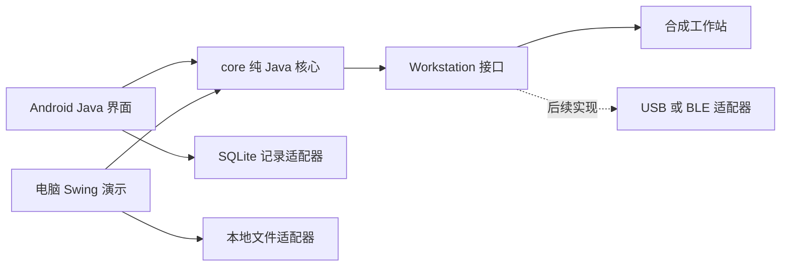

# Java 应用架构与硬件接入

## 模块依赖

核心不依赖 Android，能够在 JDK 环境下直接验证。界面只负责输入、事件和显示。`DetectionSession` 管理状态，`Calibration` 计算线性回归，`Signal` 保留采样序列，`DetectionResult` 固定保存检测结果与当次标曲，`ResultRepository` 提供保存与组合查询。

## 状态与持久化

流程为 `PREPARED → SAMPLE_ADDED → REACTING → READY → MEASURING → COMPLETED`，未完成时可以进入 `CANCELLED`。计时使用单调时钟，不受系统校时影响。重复完成被拒绝；保存失败时界面保留内存结果供重试，并明确显示未保存。

结果包含记录 UUID、虚构样品编号、类型、时间戳、I0、I1、浓度、标曲编号/k/b/r/适用区间以及电位电流序列。Android 用 SQLite 唯一主键禁止覆盖；电脑每条记录写入单独文件，通过临时文件完成写入再移动。读取损坏记录会报告错误，不悄悄跳过。

记录编码具有格式标记和有界采样点数量。数据库内为二进制 payload，便于保持两端结构一致，初版查询在应用层完成，尚未优化大量历史记录的分页。XLSX 使用 OOXML ZIP，数值写为数值单元格，文字写为 inline string，避免将样品编号当作表格公式。

## 标曲约定

输入浓度需为 5–10 个严格递增的正数；峰电流需要多一个 I0。使用中心化最小二乘计算 k/b，并以 Pearson r 表示相关系数。k 必须为正且不接近零；不设未经实验确认的 r 合格阈值。标曲适用范围为输入浓度最小值到最大值。当前线性模型是演示约定；真实信号可能需要非线性拟合、对数浓度或其他预处理，应以实验确认后单独实现。

## 真实硬件后续接入

实现 `Workstation` 的 USB 或 BLE 适配器，负责发现、握手、采集与连接状态。先确认协议、电位/电流量纲、端序、校验与超时，再将原始帧解析为 `Signal`；不能用模拟信号作为通信失败后的隐式替代。

当前接口是同步的，合成数据立即返回。真实硬件必须在后台线程处理 I/O，并加入超时、取消、中途断连、线程安全与生命周期恢复；之后补真实设备集成测试。界面初版没有部署这些硬件能力。设备连接需要的 Android 权限应仅在接入对应适配器时增加；本版无需网络、蓝牙、摄像头或全盘读写权限。

安全与数据治理也需要随真实用途重新设计：厂家授权、签名校正记录、设备身份、数据加密、访问控制、审计及备份策略。当前原型只收虚构样品编号，不能直接拿来存放个人检测数据。
