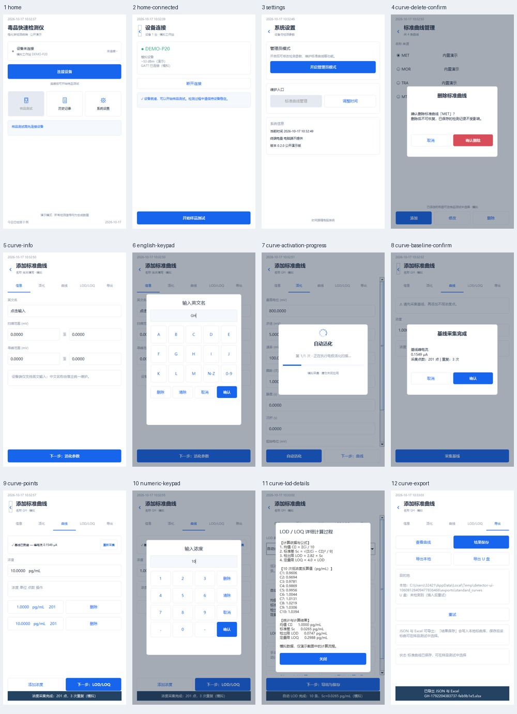

# 交互界面说明1 对照与运行说明

本次修改依据本地 `交互界面说明1.docx` 中的 39 张图片及末尾操作说明。界面使用原生 Swing 和 Android View，按照片中的页面结构、白底蓝色、选中下划线、固定底部操作栏、居中弹窗和触屏键盘实现；拍摄倾斜、屏幕偏色、遮挡不作为软件样式。运行截图位于 `docs/screenshots/reference1/`。



| 参考图片 | 实现内容 |
| --- | --- |
| 1–6 | 首页、设备列表、重新扫描、连接进度、连接完成页、直接进入样品测试准备页 |
| 7–9 | 系统设置、独立开启管理员模式、六位口令键盘、开启后返回设置页；维护入口并排排列 |
| 10–12 | 标曲单选列表、添加、修改、红色删除确认、取消删除；删除真实写入存储 |
| 13–14 | 信息页、英文名、扫描和寻峰双列范围输入；英文键盘 A–M/N–Z/数字分页 |
| 15–18 | 活化参数、可滚动输入、自动活化进度、参数数字键盘，右侧删除/清除/取消/确认 |
| 19–27 | 基线三次采集与确认、浓度编辑、三次重复采集、浓度列表、删除浓度点 |
| 28–34 | 手动 LOD、自动十次采集、均值/样本标准差/LOD/LOQ、可滚动详细计算弹窗 |
| 35–39 | 查看曲线及四个标签、结果保存、本地导出、U 盘导出入口、底部反馈 |

## 运行

在仓库根目录执行：

```powershell
powershell -ExecutionPolicy Bypass -File .\scripts\desktop.ps1
```

脚本检查 JDK 17 以上版本，依次查找显式 `-JdkHome`、`JAVA_HOME`、PATH 和本机已有构建缓存。无需 Android SDK 即可运行电脑端。可用 `-VerifyOnly` 运行核心验收，或 `-VerifyUi` 自动操作界面并截图。

操作顺序：连接设备 → 连接所选设备 → 返回首页 → 系统设置 → 开启管理员模式 → 输入公开演示口令 **123456** → 标准曲线管理 → 添加。填写英文名及有效电位范围，例如扫描 −500 至 500 mV、寻峰 −200 至 200 mV；完成活化页后采集基线并确认，再分别采集 1 和 10 pg/mL 两个浓度。进入 LOD/LOQ，手动录入正 LOD 或选择自动计算并采集十条，然后保存或导出。

## 计算和数据

新向导用每个浓度的三次平均峰电流减去已确认基线，拟合 `ΔI=kC+b`，至少两个不同浓度点，最多十点。原有 `Calibration.fit` 的相邻差值接口保留兼容。pg/mL 和 ng/L 数值相等。LOD 使用截图公式：`Sc=√[Σ(Ci−均值)²/9]`、`LOD=2.82Sc`、`LOQ=4LOD`。不复制截图中的测量结果。

标曲记录包含参数、活化曲线、三次基线、各浓度三次采集、LOD 反算值及统计结果。修改扫描或活化参数会清除后续采集；重新确认基线会清除浓度点；增删浓度点会清除旧 LOD。库在写入成功后才更新内存，取消修改不污染已保存记录，删除后重启不会复原。

电脑标曲位于 `data/curves/standard-curves.properties`，本地导出位于 `data/exports/standard_curves/`。Android 标曲位于应用私有目录，本地导出位于应用外部文件目录下的 `exports/standard_curves/`。本地导出真实生成 JSON 与 XLSX；Excel 包含参数和采样数据。电脑 U 盘入口检测系统识别的可移动盘；未检测到时提示插入后重试。Android U 盘入口调用系统文档选择器导出 Excel，可选择系统已挂载的 U 盘；取消不提示成功，JSON 可通过本地导出取得。

## 保留边界

设备名称保持 `DEMO-P20`，连接、活化、信号、LOD 重复性数据均为模拟并在界面标注。英文标曲名是本地记录名，内置四类的检测模型保持原有类型关联，新建记录默认关联甲基苯丙胺演示模型。公开口令只还原交互，不提供真实管理员安全机制。没有真实协议和实测数据，不能据此声称完成真实仪器通信或性能验证。

照片中的 Raspberry Pi 路径替换为实际运行平台路径；“调整时间”使用终端系统设置。Android 文件选择器、真实 U 盘及不同终端字体仍需真机验证。
