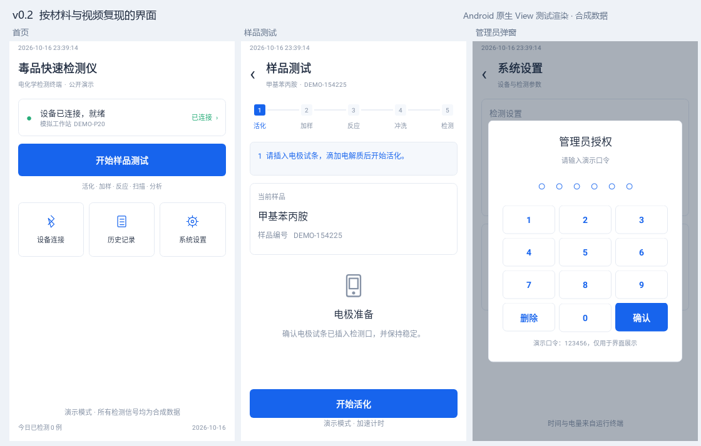

# 界面与参考材料对照

v0.2 按设备演示视频复现主要页面结构，并以页面逻辑文档补充记录列表和曲线详情。未把拍摄产生的蓝绿色偏色当作软件背景色；实现使用白色底、蓝色主操作与浅灰边框。未上传原视频、原文档或抽帧图片。

## 视觉约定

| 项目 | 实现 |
| --- | --- |
| 主色 | 蓝色 `#1764ED`，主按钮为白字蓝底 |
| 背景与边框 | 白色 `#FFFFFF`，浅底 `#F5F8FC`，边框 `#E5EAF2` |
| 文本 | 主字 `#202C40`，辅助字 `#8793A6` |
| 已完成步骤 | 绿色 `#28AD79`，当前步骤为蓝色，未开始步骤为浅灰 |
| 比例 | Android 以 360 × 640 dp 测试，同时检查 320 × 568 dp；电脑默认 440 × 780 外窗 |
| 字体 | Android 系统无衬线；电脑优先微软雅黑，字号按设备紧凑布局分级 |
| 页面结构 | 顶部时间、标题与副标题，中间可滚动内容，底部固定主操作 |

## 参考位置与实现

| 参考材料位置 | 主要特征 | 对应实现 |
| --- | --- | --- |
| 第一段视频约 0 秒，第二段约 0–32 秒 | 标题、连接状态、大蓝按钮、三项快捷入口、底部统计 | 首页与设备连接页 |
| 第一段约 14–25 秒 | 横向步骤条、当前样品信息、居中活化弹窗 | 五段步骤条与模拟活化进度 |
| 第一段约 145 秒 | 反应计时提示 | 等待反应页；保留不可提前继续的流程约束 |
| 第一段约 155 秒 | 冲洗/反应液完成后开始检测 | 冲洗页与固定底部检测按钮 |
| 第一段约 205–218 秒 | 检测结果、类型、时间、样品编号 | 结果信息页及历史记录 |
| 第一段约 230 秒，第二段约 48–64 秒 | 居中管理员弹窗、六位圆点、数字键盘 | 演示授权弹窗 |
| 第一段约 248 秒 | DPV 曲线与峰电流计算 | 详情中的“DPV 曲线”和“计算详情”标签页 |
| 第二段约 82 秒、875 秒 | 标曲管理列表 | 按四种类型列出内置演示标曲 |
| 第二段约 130–230 秒 | 蓝色旋转指示、进度条、提示文字 | 活化、连接、检测的统一进度弹窗 |
| 页面逻辑文档的记录与详情图 | 列表、查看详情、查询、导出和曲线 | 记录卡片、多选导出、详情标签页和原生绘图 |

## 有意保留的差异

演示终端名为 DEMO-P20，不冒充视频中的真实设备身份。检测完成显示“模拟检测完成”及合成浓度，不复用“未检出”或“超过阈值”等尚未实现的判断。数字键盘使用公开口令 123456，仅复现交互，不是厂家安全控制。

视频中的原始曲线、扫描协议、真实蓝牙地址、厂家口令和实际 LOD/LOQ 参数未复制。标曲仍通过基础版的浓度/峰电流输入拟合，未把视频中的逐点硬件采集和自动 LOD 计算呈现为已实现功能。操作过程的合成标识始终可见。

## 页面证据

`screenshots/android-*.png` 来自 Android 原生 View 的 Robolectric NATIVE 测试渲染，非美术稿、非真机截图。`screenshots/desktop-*.png` 来自实际 Swing 窗口的绘制。所有记录均为测试生成的虚构样品。

